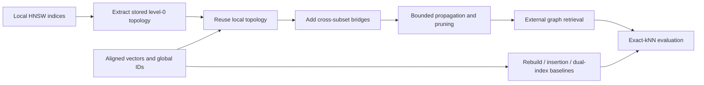

# MetricDB: Vector Index Transformation and Merging

**MSc dissertation · University of Edinburgh · Python / NumPy / FAISS / HNSW**

[中文介绍](README.zh-CN.md) · [Code guide](docs/CODE_GUIDE.md) · [Reproduction instructions](REPRODUCIBILITY.md) · [Results](results/) · [Resume wording](docs/RESUME.md)

How can independently built vector indices be reused after their embeddings have been aligned into a shared space? This research implementation extracts stored HNSW level-0 graphs, preserves local connectivity, adds cross-subset bridges, and evaluates bounded propagation against rebuilding and insertion.

The dissertation is titled *Transforming and Merging Vector Indices for Unified Retrieval in MetricDB*. This repository publishes the curated submission implementation and compact experimental evidence, with an overview for reviewers.

## Implemented work

- A common index adapter for native FAISS HNSW and an external graph backend, including ID mapping, input validation, search diagnostics, and serialization.
- Exact and noisy alignment conditions, topology extraction, local repair, indexed cross-subset bridges, and bounded/unlimited propagation.
- Brute-force ground truth and full-rebuild, incremental-insertion, dual-index, disconnected, random-link, and sampled cross-kNN baselines.
- Synthetic experiments using 10k–50k source datasets, sequential integration of three subsets, and evaluation over a 25k-vector GloVe union.
- Recall, latency, integration cost, graph connectivity, query-work accounting, paired bootstrap intervals, and checksum validation of frozen evidence.

The dissertation contribution is the metric-indexing and experimental path. Other MetricDB modules are shared cluster-project scaffolds; their presence does not establish a completed end-to-end database. Original team attribution and the MIT license are retained.

## Method



The reused representation is **stored level-0 topology**. It is not a physical merge of complete multi-layer FAISS HNSW indices. Known alignment transformations and controlled noise are experiment inputs; learning an embedding alignment model is outside this implementation.

## Selected result

For the **33,334-vector pair drawn from the 50k synthetic source**, bounded N8/C2 propagation improves Recall@10 over random direct links by **5.63 percentage points**, with a paired bootstrap 95% interval of **[5.36, 5.93] percentage points**. See [the retained interval estimates](results/scaling_confidence_intervals.json) and [the corresponding table](dissertation_assets/scaling_ci_table.tex).

This result compares two topology-reuse strategies. It does not establish superiority over native rebuilding: the [50k stopping gate](results/cycle21_50k_compact.json) shows that the informed variants failed the configured recall/cost criteria against native baselines. The native and Python graph backends also differ in execution overhead. These trade-offs are part of the research findings.

## Quick start

Run from the repository root; Python 3.10 is the recorded experiment version.

```bash
python3.10 -m venv .venv
source .venv/bin/activate
python -m pip install -r requirements.txt

# Validate all nine frozen evidence artifacts without regenerating them.
python data/validate_final_evidence.py --require-complete

# Run the 85 research-path tests.
python -m unittest discover tests

# Exercise native/external index adapters on a small self-contained dataset.
python data/run_cycle22.py --output scratch/cycle22_smoke.json
```

For a small alignment and baseline pipeline:

```bash
python data/run_phase1.py \
  --config configs/phase1_smoke.json \
  --output-root scratch/phase1_smoke
```

Smoke outputs verify execution and are separate from the retained formal results. Large raw arrays, native indices, GloVe downloads, the dissertation PDF, and personal resume files are excluded. A complete formal rerun requires regenerating or reacquiring the inputs described in [REPRODUCIBILITY.md](REPRODUCIBILITY.md).

## Where to read the code

| Area | Entry point |
|---|---|
| Index contract and adapters | [core/base.py](core/base.py), [indexing.py](modules/metric_indexing/indexing.py) |
| Graph extraction, repair, and search | [phase2_graph.py](data/phase2_graph.py) |
| Bridges, propagation, and pruning | [phase3_merge.py](data/phase3_merge.py) |
| Operational baselines | [phase3_baselines.py](data/phase3_baselines.py) |
| Sequential integration | [phase4_sequential.py](data/phase4_sequential.py) |
| Timing and statistics | [phase4_benchmark.py](data/phase4_benchmark.py), [phase4_statistics.py](data/phase4_statistics.py) |
| Evidence and configuration | [results/](results/), [configs/](configs/), [MANIFEST.md](MANIFEST.md) |

The detailed [code guide](docs/CODE_GUIDE.md) connects these files to reviewable engineering decisions. GitHub Actions runs the existing research tests and strict evidence validation on pushes and pull requests.
